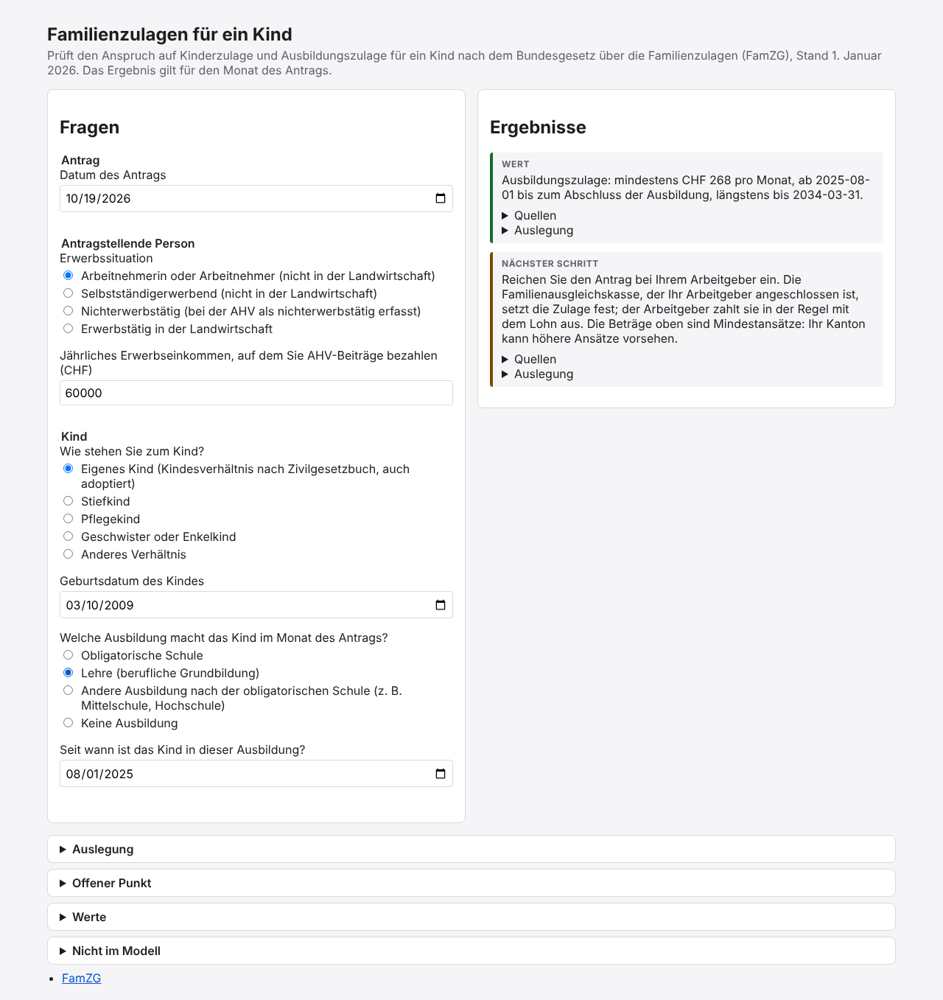

# Software that knows: family allowances for one child

This project is a small browser application for one process under Swiss law:
the family allowances for one child (child allowance and education allowance)
under the Federal Act on Family Allowances (FamZG), version of 1 January 2026.



## Architecture

| Part | File | Contents |
| --- | --- | --- |
| Knowledge model | `model/famzg.ttl` | All knowledge of the law. Questions are SHACL shapes. Rules are SHACL-SPARQL constraints, each with a message (`sh:message`) and its sources (`dcterms:source`). Sources use the ELI ontology. |
| Vocabulary | `model/vocabulary.ttl` | The small vocabulary `stk:` for what the standards cannot express: process, relevance of a question, result type, parameter, interpretation, open point. It contains no knowledge of a law. |
| Generator | `generator/generate.ts` | Deterministic, no LLM. It reads the model and the vocabulary and writes `app/generated/model.json`: JSON Schema, UI schema and JSON-LD context for the form, rule metadata, sources, parameters, interpretations and open points. It knows SHACL, RDF, JSON-LD and the vocabulary, not the law. |
| App | `app/` | React and JSON Forms. After each answer, `app/engine.ts` converts the form data to RDF (JSON-LD), and checks it with the SHACL engine [`shacl-engine`](https://github.com/rdf-ext/shacl-engine) and its SPARQL plug-in. |

### How the app uses the model

1. **Relevance.** A question (a property shape) with `stk:relevantIf` is asked only if the
   answers conform to that node shape. The app validates the condition shapes with the SHACL
   engine. It removes the answers to questions that are not relevant, and repeats until the set
   of relevant questions does not change.
2. **Results.** The app validates all answers against the model. Each validation result of a
   constraint with `stk:resultType` is one result: `stk:Refusal`, `stk:Value` or `stk:NextStep`.
   The message, the main value (`?value`) and the sources come from the model.
3. **Parameters.** Values that rules need (for example the minimum rates) are `stk:Parameter`
   nodes with a source. The generator copies their `rdf:value` into the data graph, so that the
   SPARQL queries can read them.
4. **Interpretations and open points** are `stk:Interpretation` and `stk:OpenPoint` nodes. The
   app shows them under the results and at the bottom of the page. A rule that cannot be executed
   is a shape with `sh:deactivated true`.

## Commands

You need [Bun](https://bun.sh) 1.4 or later. The browser test needs Chromium; set
`CHROMIUM_PATH` if it is not at `/opt/pw-browsers/chromium`.

```sh
bun install            # install the dependencies
bun run generate       # model -> app/generated/model.json
bun run dev            # generate, then start the app on http://localhost:3000
bun run build          # generate, then build the app into dist/
bun run typecheck      # TypeScript check
bun run test           # generate, then run all tests (also the browser test)
bun test tests/happy-path.test.ts   # only the happy path through the form data and the SHACL engine
bun run test:browser   # only the happy path in Chromium
```

## Tests

| Test | What it checks |
| --- | --- |
| `tests/happy-path.test.ts` | The happy path through the form data and the SHACL engine: education allowance, at least CHF 268 a month, at the latest until 2034-03-31, sources FamZG Art. 3 Abs. 1 Bst. b and Art. 5 Abs. 2. |
| `tests/rules.test.ts` | Relevance of questions after each answer, and the other results (child allowance, refusals, next steps, leap year). |
| `tests/no-law-in-code.test.ts` | The generator and the app contain no word and no number of the law. The test takes the words and numbers from the model and searches the code. |
| `tests/generator.test.ts` | The generator is deterministic, the generated file is up to date, and a rule without a message or a source is refused. |
| `tests/browser/happy-path.browser.test.ts` | The happy path in Chromium: fill in the form, read the results. |

## Notes about the SHACL engine

- `shacl-engine` 1.1.3 executes only the first `sh:sparql` constraint of a shape. The model
  therefore puts each rule into its own property shape.
- SPARQL-based targets ignore `sh:prefixes`. The target queries contain their own `PREFIX` lines.
- Message templates keep the N-Triples form of literals (`"268"^^<…>`) and replace only the first
  use of a variable. The app removes the N-Triples syntax; each message uses a variable only once.
- The engine starts a new SPARQL engine for each query. One evaluation takes approximately one
  second.
