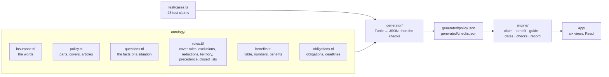

# car-insurance

A demonstrator. The General Conditions of Insurance of a motor vehicle insurance product are written
down as an ontology: the covers, the rules, the numbers and the obligations, each with the article
it comes from. Six applications are derived from this one model. They run in the browser.

Source: Zurich Insurance Company Ltd, *Motor vehicle insurance: Customer information, General
Conditions of Insurance (GCI)*, edition 01/2015, English version (the German version prevails).

> **Demonstration only. Not insurance advice.** Not made or checked by Zurich. The model is our
> reading of the document; the policy and the German text of the conditions decide.

## The applications

| View | Question | What the model gives it |
| --- | --- | --- |
| Claim check | Is this damage covered, and how much does the insurer pay? | Cover rules, exclusions, reductions, precedence, the product overview, the compensation table, the numbers |
| After an event | What must I do now, and what happens if I do not? | The obligations, with conditions and consequences |
| Dates | By which day must I act? | The deadlines: a date of the user moved by a duration of the model |
| Compare | What does an option add? | The status of each cover per vehicle class, the benefits with their limits |
| Policy explorer | What does this article say, and what does it change? | The articles, their references, and the source of every statement |
| Model checks | Is the model complete, and does the document contradict itself? | All of it |

The landing page of the app describes each view. Two more applications need a language model and a
server, so they are not in this demonstrator: questions in your own words, and tools for agents.
Both would call the same engine.

What is modelled: accidental damage insurance (Art. 201 to 204) rule by rule, so the claim check
decides its claims. The other parts are in the model with their covers, benefits, articles and some
rules, so the comparison, the explorer, the guide, the dates and the checks use them.

## How it works



- **The engine knows the words, not the product.** It knows cover, exclusion, reduction, waiver,
  precedence, obligation and deadline (`ontology/insurance.ttl`). The product is the generated
  policy. The calculation of an amount (`engine/benefit.ts`) is code: its numbers come from the
  model, and the test claims keep the two in step.
- **Only the questions that matter.** The claim check asks a question only when a rule that can
  still apply needs its answer. A test claim needs 11 of the 38 questions on average.
- **Precedence is explicit.** Where two statements apply to the same claim with opposite effects,
  `ins:Precedence` says which one wins, and on what basis: the text, or our interpretation.

## The checks

The generator runs the checks at build time and writes the report to `generated/checks.json`. The
app shows it in the Model checks view; a test fails the build on an open finding.

| Check | What it finds |
| --- | --- |
| Every statement has its source | A rule, limit or deadline without an article; a reference to an article that is not there |
| The product overview is complete | A cover without a status for a vehicle class |
| No dead questions, no dead rules | A question that no rule needs; a rule whose conditions can never hold |
| No contradictions between statements | Two statements about the same thing, with opposite effects, that can apply to the same claim, and nothing says which one wins |
| Repeated statements agree | The same number or benefit stated twice with different values |
| The compensation table is consistent | A missing year; a share that goes up |
| The test claims give the expected decisions | A claim whose status, cover, rules or payment changed |

On this document they find five places that need a decision:

| Where | What | Decided by |
| --- | --- | --- |
| Art. 3 and 406 | Art. 3: roadside assistance only in Switzerland and Liechtenstein. Art. 406: roadside assistance Europe within Europe. | Our interpretation: Art. 3 is about roadside assistance CH/FL |
| Art. 202.3 f and 204.1 | Punctured tyres are vandalism; damage only to the tyres is excluded. | Our interpretation: the closed list of vandalism wins |
| Art. 406.7 | The onward journey after the loss of keys is listed twice: without a limit, and up to 2000 CHF. | Our interpretation: the limit applies |
| Art. 3 and 301.3 | Outside the territory, but accidents in other people's vehicles are covered worldwide for six weeks. | The text |
| Art. 202.2 and 203.7 | Gross negligence reduces benefits; the option waives the reduction for collision. | The text |

The checks also show where the document is consistent: Art. 5 and 6.1 both count an insurance year
of at least 11 months; collision as a consequence of wear (Art. 202.1) and wear itself (Art. 204.1)
never apply to the same claim.

A check finds only what the model says. It cannot show that the model says what the document says:
that is the job of the person who writes the model, and of the test claims.

## Commands

```sh
bun install
bun run generate    # ontology/ → generated/policy.json and generated/checks.json
bun run dev         # http://127.0.0.1:3013/
bun run test        # the checks, the test claims, the engine
bun run typecheck
bun run build       # a static site in dist/
```

## Licence

The code is MIT. The ontology and the generated files are a model of a document of Zurich Insurance
Company Ltd: they are not licensed (see [`REUSE.toml`](../REUSE.toml)).
