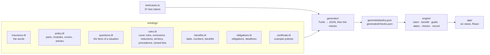

# car-insurance

A demonstrator. The General Conditions of Insurance of a motor vehicle insurance product are written
down as an ontology: the covers, the rules, the numbers and the obligations, each with the article
it comes from. Six applications are derived from this one model. They run in the browser.

Source: Zurich Insurance Company Ltd, *Motor vehicle insurance: Customer information, General
Conditions of Insurance (GCI)*, edition 01/2015, English version (the German version prevails).

> **Demonstration only. Not insurance advice.** Not made or checked by Zurich. The model is our
> reading of the document; the policy and the German text of the conditions decide.

## The applications

| View | Question | What the model gives it |
| --- | --- | --- |
| Claim check | Is this covered by my policy, and how much does the insurer pay? | Cover rules, exclusions, reductions, precedence, modules, the product overview, the compensation table, the numbers, the certificate |
| After an event | What must I do now, and what happens if I do not? | The obligations, with conditions and consequences |
| Dates | By which day must I act? | The deadlines: a date of the user moved by a duration of the model |
| Compare | What does an option add? | The status of each cover per vehicle class, the benefits with their limits |
| Policy explorer | What does this article say, and what does it change? | The articles, their references, and the source of every statement |
| Model checks | Is the model complete, and does the document contradict itself? | All of it |

The landing page of the app describes each view. Two more applications need a language model and a
server, so they are not in this demonstrator: questions in your own words, and tools for agents.
Both would call the same engine.

What is modelled:

- **The product and the policy are apart.** The General Conditions say what each *module* covers
  (third party liability, collision, partial casco, accident, roadside assistance, legal
  protection). In the product overview, a dot means "in the basic scope of the module", not "in
  every policy": only third party liability is in every policy. The *certificate* of a policy
  (`ontology/certificate.ttl`) says which modules and options it includes, with its sums. The
  claim check and the guide read the certificate and do not ask about it.
- **Accidental damage insurance** (Art. 201 to 204) is modelled rule by rule, with the amount.
- **The other modules**: the events that belong to them (a breakdown, an injury, a claim against
  you, a legal case), their exclusions (the ones of Art. 204 that Art. 304 and 407 use again, and
  the territory), and their benefits. The claim check says whether the policy has the module, and
  what it pays; it does not calculate their amounts.

## How it works



- **The engine knows the words, not the product.** It knows module, cover, exclusion, reduction,
  waiver, precedence, certificate, obligation and deadline (`ontology/insurance.ttl`). The product is the generated
  policy. The calculation of an amount (`engine/benefit.ts`) is code: its numbers come from the
  model, and the test claims keep the two in step.
- **Only the questions that matter.** The claim check asks a question only when a rule that can
  still apply needs its answer. A test claim needs 9 of the 32 questions on average; the
  certificate gives the rest.
- **Precedence is explicit.** Where two statements apply to the same claim with opposite effects,
  `ins:Precedence` says which one wins, and on what basis: the text, or our interpretation.

## The checks

The generator runs the checks at build time and writes the report to `generated/checks.json`. The
app shows it in the Model checks view; a test fails the build on an open finding.

| Check | What it finds |
| --- | --- |
| Every statement has its source | A rule, limit or deadline without an article; a reference to an article that is not there |
| The product overview is complete | A cover without a status for a vehicle class |
| The certificates agree with the product | A certificate without an answer; an option that the overview does not offer for the vehicle, or without its module |
| No dead questions, no dead rules | A question that no rule needs; a rule whose conditions can never hold |
| No contradictions between statements | Two statements about the same thing, with opposite effects, that can apply to the same claim, and nothing says which one wins |
| Repeated statements agree | The same number or benefit stated twice with different values |
| The compensation table is consistent | A missing year; a share that goes up |
| The test claims give the expected decisions | A claim whose status, cover, rules or payment changed |

On this document they find six places that need a decision:

| Where | What | Decided by |
| --- | --- | --- |
| Art. 3 and 406 | Art. 3: roadside assistance only in Switzerland and Liechtenstein. Art. 406: roadside assistance Europe within Europe. | Our interpretation: Art. 3 is about roadside assistance CH/FL |
| Art. 202.3 f and 204.1 | Punctured tyres are vandalism; damage only to the tyres is excluded. | Our interpretation: the closed list of vandalism wins |
| Art. 202.3 c and 204.1 | Floods are a natural hazard; damage due to the operation of the vehicle is excluded. A vehicle that is driven into water fits both. | Our interpretation: damage due to operation, as in the usual practice |
| Art. 406.7 | The onward journey after the loss of keys is listed twice: without a limit, and up to 2000 CHF. | Our interpretation: the limit applies |
| Art. 3 and 301.3 | Outside the territory, but accidents in other people's vehicles are covered worldwide for six weeks. | The text |
| Art. 202.2 and 203.7 | Gross negligence reduces benefits; the option waives the reduction for collision. | The text |

The checks also show where the document is consistent: Art. 5 and 6.1 both count an insurance year
of at least 11 months; collision as a consequence of wear (Art. 202.1) and wear itself (Art. 204.1)
never apply to the same claim.

A check finds only what the model says. It cannot show that the model says what the document says:
that is the job of the person who writes the model, and of the test claims.

## Evaluation

Five questions of users, on a certificate with partial casco, collision, accident insurance and
Help Point PLUS, but without roadside assistance, legal protection or items transported
(`ExampleCertificate`). They are test claims now (`test/cases.ts`, "Evaluation").

| # | Question | Expected | First version | Now |
| --- | --- | --- | --- | --- |
| 21 | Is damage from driving on a flooded road covered? | Not covered (Art. 204.1) | Covered, as a flood | Not covered: driving into water is damage due to operation (Art. 204.1), marked as our interpretation |
| 22 | Can I use my motor insurance to sue someone who damaged my car? | Not covered: no legal protection | Out of scope; the model read legal protection as part of every policy | Not covered: the module is not in the policy; it shows what Art. 502.1 would cover. A claim against *you* goes to the liability insurance, which defends you |
| 23 | Injured as a passenger in my own car: medical expenses? | Covered | Out of scope | Covered (Art. 302, 303.5), with the sums of the certificate: death 30,000, disability 60,000, daily allowances 25 |
| 24 | My car broke down on the autobahn: will Zurich tow me? | Not covered: no roadside assistance | Right verdict for the wrong reason; the guide said to call Zurich for help | Not covered: the module is not in the policy (Art. 403, 406). The guide says to call a breakdown service. Help Point PLUS is not linked to towing |
| 25 | My window was smashed and my laptop stolen: is the laptop covered? | Not covered: no items transported | Right by the "items" path; "Theft" gave covered | Not covered: the option is not in the policy. The theft question now has "items in the vehicle were stolen", which leads away from Theft. The window is a second claim: Glass, covered |

What the evaluation taught:

- **Product and contract were one thing in the model.** One wrong idea ("basic" read as "in every
  policy") on one property affected 25 covers; the fix is a new concept (module, certificate),
  not new code for each case. The checks could not find it: they test that the model agrees with
  itself, and it did. Only cases from a real certificate showed it.
- **A rule must use only the questions of its cover.** The first version of the water exclusion
  had two alternative conditions: one about natural hazards, one about the engine. The test claims
  showed that the claim check then asked "Which natural hazard?" after a collision. It is two rules
  now, one for each cover.
- **What the model cannot do.** The step from the user's words ("stole", "flood") to an answer of
  the form is still the user's. The model can make the answers finer and explain them; turning free
  text into answers is the language-model layer that this demonstrator does not have. A claim
  decides one event: the window and the laptop of case 25 are two claims.

## Commands

```sh
bun install
bun run generate    # ontology/ → generated/policy.json and generated/checks.json
bun run dev         # http://127.0.0.1:3013/
bun run test        # the checks, the test claims, the engine
bun run typecheck
bun run build       # a static site in dist/
```

## Licence

The code is MIT. The ontology and the generated files are a model of a document of Zurich Insurance
Company Ltd: they are not licensed (see [`REUSE.toml`](../REUSE.toml)).
