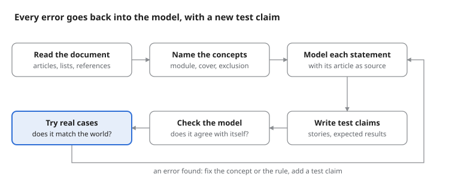

# Insurance policies as ontologies: lessons learned

*17 October 2026*

## Context

One real insurance document was written down as an ontology, and software was built to read it. The document is the General Conditions of a Swiss motor vehicle insurance (Zurich, edition 01/2015): 20 pages, about 130 articles.

The model holds the covers, the rules, the numbers, the obligations and the deadlines of the document. Every statement in it names the article that it comes from. Six small applications read the model: a claim check, a guide after an accident, a list of deadlines, a comparison of options, an explorer of the articles, and a report of checks on the model itself.

This recap is about the modelling, not the software. It lists the lessons about how to model a policy, what the insurance domain makes hard, and the modelling errors that occurred and how they were found. In short: the hard part is not the technology. It is to decide exactly what the document means, and to notice when it does not say.

## The modelling process

The document was not modelled in one pass. The work went round the same loop several times, and each round brought the model closer to what the document means.

*The modelling loop: 6 steps, 1 return path*

The last two steps find different errors (Lesson 5). Real cases from outside found the biggest error, so that step is marked. Each error went back into the model, as a corrected concept or rule, and into the test claims, so that it cannot come back.

## Lesson 1: the product is not the contract

The biggest error was to model the General Conditions as if they were the customer's policy. The General Conditions describe a product: all the modules and options that a customer can buy. The policy certificate says which of them one customer has, with the sums insured.

**The error.** The product overview on page 3 marks covers with a filled dot. The model read the dot as "in every policy". It means "in the basic scope of the module, when the customer buys the module". Only third party liability is in every policy, because the law requires it. Accident insurance, roadside assistance and legal protection are modules that a customer buys or not.

**How it was found.** Not by reading, and not by the automatic checks: the model agreed with itself. Five questions about a real certificate showed it. The certificate said "roadside assistance: no" and "legal protection: no", and the model could not even express that.

**The fix.** Two new concepts: a *module* (a unit that a policy has or not) and a *certificate* (the answers of one policy: which modules, which options, which sums). The claim check now asks the certificate first: is the module in this policy? Is the option in this policy? Only then does it look at the rules.

**Why it matters.** One wrong idea in one place affected 25 covers. And one right concept fixed all of them, without a special case for each. When a model is wrong in many places in the same way, look for a missing concept, not for many small fixes.

## Lesson 2: the document contradicts itself, so precedence must be explicit

A well-written policy still has places where two articles say opposite things about the same claim. A person reads one article at a time and does not notice. A model sees all statements about the same thing at once, so it finds them.

Six such places were found in this document:

| Articles | The two statements | Who decides which one wins |
| --- | --- | --- |
| Art. 3 and 406 | Roadside assistance only in Switzerland and Liechtenstein; roadside assistance Europe within Europe | Interpretation |
| Art. 202.3 f and 204.1 | Punctured tyres are vandalism; damage only to the tyres is excluded | Interpretation |
| Art. 202.3 c and 204.1 | Floods are a natural hazard; damage due to driving the vehicle is excluded. A car driven into a flooded road fits both | Interpretation |
| Art. 406.7 | The same benefit is listed twice: once without a limit, once up to 2000 CHF | Interpretation |
| Art. 3 and 301.3 | Outside the territory there is no cover; accidents in other people's vehicles are covered worldwide for six weeks | The text |
| Art. 202.2 and 203.7 | Gross negligence reduces benefits; an option waives the reduction for collision | The text |

**The lesson.** A rule alone is not enough. The model needs a second kind of statement: *this rule wins over that rule*, with its basis. The basis is either the text (the document says so) or an interpretation (the document does not, so one reading is chosen and the reason is written down). The application shows the basis next to every decision that depends on it.

**Why it matters.** Without explicit precedence, the order of the rules in the code decides silently. With it, every interpretation is visible and has a reason. Before production, the insurer must confirm each interpretation. The model gives them the exact list.

The same check also confirms where the document is consistent. For example, two articles both say that an insurance year counts if it lasts at least 11 months.

## Lesson 3: know what the model can decide, and what it must hand to a person

Insurance text mixes three kinds of statement. The model must treat each one differently.

- **Closed lists.** Some lists say that they are "exhaustive and conclusive": vandalism, theft, glass, protective clothing. What is not on the list is not covered. Scratched paint is not vandalism under this policy, because the list names painting and spraying, but not scratching. The model must mark a list as closed. Otherwise a reader, or a program, treats the list as examples.
- **Exact numbers and conditions.** Limits, deadlines, the compensation table, 1.6 per mille, 75 km/h wind. These the model can decide completely.
- **Vague words.** "Reasonable costs", "particularly flagrant", "reduced by the degree of fault". The model cannot calculate these, and it must not pretend to. It says "covered, with a possible reduction; a person decides the amount".

**The lesson.** Mark the limit of the model in the model. A decision that ends in "a person decides" is a correct answer, not a gap. It is better than an invented number.

The same applies to outside sources. The replacement value of a car comes from a valuation guide that is not in the document. The model can name that source, but it does not contain it.

## Lesson 4: every rule has a scope, and the scope is part of its meaning

Two modelling errors came from rules that applied to more than they should.

**The water exclusion.** "Driving into water is damage due to operation" was first written as one rule with two alternatives: a natural hazard (the car drove into a flood) or a collision (water got into the engine). The rule was right in meaning, but it covered both events at once. So after a simple collision, the claim check asked "which natural hazard?". The fix split it into two rules, one for each cover. A rule should use only the questions that belong to its own cover.

**The alcohol exclusion.** Several modules use the exclusions of Art. 204 again: the accident insurance (Art. 304) and roadside assistance (Art. 407). The model had one rule shared by three modules. That was good, but one detail was lost. Art. 304 uses the alcohol exclusion only "insofar as the driver's claims are affected". The model excluded every injured person when the driver was drunk, so a passenger lost the accident benefits. The fix: the accident insurance has its own rule, with "the injured person is the driver" as a condition.

**The lesson.** When an article refers to another article, read the reference words with care: "applies", "applies except", "applies insofar as". Each one gives a different scope. A shared rule is good modelling, but only when the scope is the same everywhere.

## Lesson 5: a consistent model is not yet a correct model

Two kinds of test were used on the model, and they found different errors.

|  | Checks on the model | Test claims and real cases |
| --- | --- | --- |
| What they compare | The statements of the model with each other | The decisions of the model with the expected decisions |
| What they found | The six contradictions of Lesson 2, gaps in the product overview, questions that no rule needs | The product-versus-contract error, the water rule, the alcohol rule |
| What they cannot find | A statement that is wrong but consistent | A problem that no case touches |

**The lesson.** Checks show that the model agrees with itself. Only cases show that the model agrees with the world. The biggest error (Lesson 1) passed every check, because it was wrong in the same way everywhere.

**Test claims as the specification.** Each test claim is a small story with an expected result: the answers of a customer, and the expected decision, cover, rules and amount. They became the specification of the model. Each new error became a new test claim, so it cannot come back. The alcohol error was found only when someone asked "what about the passenger?": no claim covered that case.

**Cases from outside are the most valuable.** Test claims written by the modeller follow the modeller's own understanding. The five questions about a real certificate, written by someone else, found what the modeller could not see.

## Lesson 6: the hardest step is from the customer's words to the model's facts

The model decides well once it has the right facts. The risk is in how a customer's words become those facts.

- **"Stole" is not always theft.** "Someone smashed my window and stole my laptop" sounds like theft. But theft in this policy is theft of the vehicle or its parts. A laptop is an item in the vehicle, which is a separate option. The first version let a user answer "theft" and get "covered". The fix was a finer answer: "items in the vehicle were stolen". It leads away from theft on purpose.
- **"Flood" is two events.** A flood that reaches a parked car is a natural hazard. A car driven into a flooded road is damage due to operation. The customer says "flood" in both cases. The model needs a question that separates them.
- **One question can hold two claims.** The smashed window and the stolen laptop are two claims with two answers: the window is covered by glass cover, the laptop is not covered. A form that decides one event at a time must say so.

**The lesson.** Every answer of a question is a modelling decision. Make the answers fine enough that a customer cannot choose a wrong path by accident, and explain each answer in plain words. Turning free text into these facts is a separate task. A language model could do it, but the ontology must define the facts it maps to, and decide.

## A checklist for the next policy

- [ ] Get a real certificate and real customer questions before the modelling starts, not after.
- [ ] Separate the product (what can be bought) from the contract (what one customer has) from day one.
- [ ] Give every statement the article it comes from.
- [ ] Mark each list as open (examples) or closed (exhaustive).
- [ ] Mark each vague word as "a person decides", and never turn it into a number.
- [ ] For every reference between articles, write down its scope: all, all except, or insofar as.
- [ ] For every place where two statements meet, record which one wins and why: the text, or an interpretation.
- [ ] Keep a list of interpretations for the insurer to confirm.
- [ ] Write test claims as stories with expected results; add one for every error found.
- [ ] Ask "who else?" for every exclusion: the driver, a passenger, a helper, a person of the household.
- [ ] Read every answer of every question as a customer would, and look for the wrong path.

## Open questions

- **Who confirms an interpretation?** The model makes each interpretation visible. But who in an insurer owns the answer: legal, product, or claims? And how does the answer get back into the model?
- **How do versions work?** Policies change by edition, and old contracts keep old conditions. Can one model hold two editions, and show what changed between them?
- **Can the words of a policy be reused?** Module, cover, exclusion, precedence and certificate were not specific to this insurer. Would a second insurer's motor policy fit the same words? A home or travel policy?
- **Where is the line for a language model?** It could turn a customer's story into facts. How can that step be tested as strictly as the rules?
- **What about the parts that are not modelled rule by rule?** Liability and legal protection have their own exclusions (Art. 104 and 505). Do they bring new kinds of problems, or more of the same?
