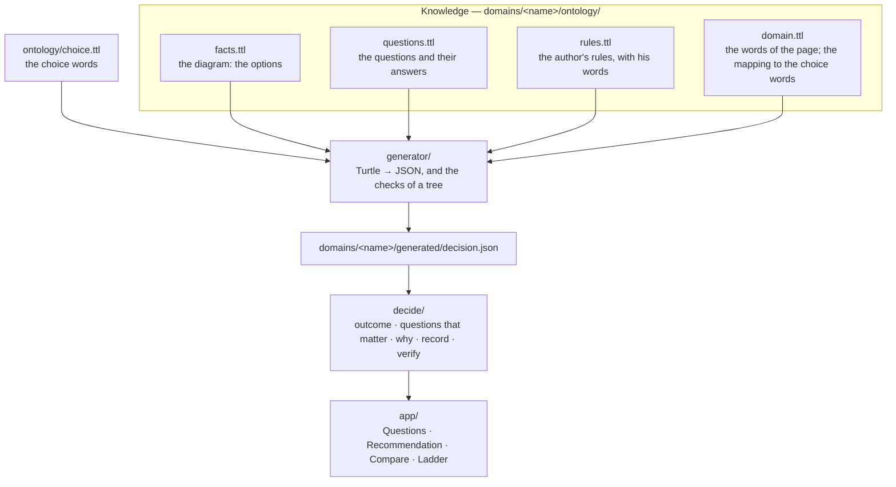

# Choices

One generic decision app, two domains. Each domain is one of Alok Sharan's diagrams, written down
as an ontology:

| Domain | Source | The app recommends |
| --- | --- | --- |
| [`cloud-architecture`](domains/cloud-architecture/) | [Microservices VS Serverless VS Modular Monolith](https://www.linkedin.com/feed/update/urn:li:activity:7514433067860582400/): a comparison of 3 styles, and the heuristics of the post | An architecture style for a team, with serverless parts |
| [`chatgpt-models`](domains/chatgpt-models/) | [ChatGPT Model Tree](https://lnkd.in/p/efs4j4NS): a decision tree to 6 models, and an effort ladder | A model for a task, where to start on the ladder, and a brief |

The code (`app/`, `decide/`, `generator/`) knows no domain: it knows the words of
[`ontology/choice.ttl`](ontology/choice.ttl), such as option, criterion, choice rule and step. Each
domain is four Turtle files, and the generator writes one JSON file from them. The app asks one
question at a time, and only the questions whose answer can still change the recommendation.

The `cloud-architecture` domain is the app of part 7 ([`../cloud-architecture/`](../cloud-architecture/))
on this code. Its three files of knowledge are part 7's files, unchanged, and a test checks that it
decides the same in all 13,122 situations.

> The diagrams and the posts are Alok Sharan's. They state no licence: the files extracted from
> them, and the generated files that hold their content, are not licensed (see Licences).

## One shape for every domain



| File | `cloud-architecture` | `chatgpt-models` |
| --- | --- | --- |
| `facts.ttl` | 3 styles × 8 dimensions, and their tools | 6 models × 7 dimensions, and the effort levels |
| `questions.ttl` | 8 questions about the team | the 5 questions of the tree, and the plan |
| `rules.ttl` | 2 style rules, 2 part rules, 2 cautions, written as conditions | the tree, written as its arrows; 4 cautions about plans; the 7 steps of the ladder |
| `domain.ttl` | the words of the page, and the mapping of part 7's words to the choice words | the words of the page, and the first question of the tree |

What the two domains use differently, all of it in the choice words:

- **Conditions or a tree.** Part 7 writes the conditions of each rule. The model tree writes the
  arrows of the drawing (`choice:branch`), and the generator writes the conditions from the path to
  each model.
- **A ladder.** Only the model tree has one (`choice:Step`): the recommendation says where to start,
  and what to try when the result falls short.
- **Cautions for one choice.** A caution about a plan applies only to the model that it is about
  (`choice:whenChosen`).
- **A mapping.** Part 7's files use their own words (`arch:StyleRule`); `domain.ttl` maps them to the
  choice words with `rdfs:subClassOf` and `rdfs:subPropertyOf`, and the generator applies the
  mapping before it reads the model.

## Checking the model

`bun run verify` checks every domain. The same checks run in `test/domains.test.ts`.

```
┌────────────────────┬────────────┬────────────────────┬────────────────────┐
│                    │ situations │ structure findings │ behaviour findings │
├────────────────────┼────────────┼────────────────────┼────────────────────┤
│     chatgpt-models │ 128        │ 0                  │ 0                  │
│ cloud-architecture │ 13122      │ 0                  │ 0                  │
└────────────────────┴────────────┴────────────────────┴────────────────────┘
```

| Check | Finds | Where |
| --- | --- | --- |
| One arrow per answer | a question of the tree with an answer that leads nowhere, or to two places | `generator/generate-decision.ts` (a SPARQL query) |
| One path per choice | a model of the tree that no path leads to, or that two paths lead to | `generator/generate-decision.ts` |
| Gap | a situation without a recommendation | `decide/verify.ts` |
| Overlap | a situation where two choice rules apply. The first one wins, so the order hides the conflict; the check ignores the order | `decide/verify.ts` |
| Never chosen, never applies | a rule that no situation uses | `decide/verify.ts` |
| Ladder | a step where the effort of a model goes down | `decide/verify.ts` |

The structure checks need a tree. The behaviour checks need only the rules, so they work for both
domains.

### Two readings of the model tree

The diagram, as drawn, does not pass. `domains/chatgpt-models/test/drawn/rules.ttl` keeps the tree
and the ladder as drawn, and `bun run verify chatgpt-models domains/chatgpt-models/test/drawn/rules.ttl`
shows what the checks find:

```
structure: Ambiguous: 2 arrows for "yes"
structure: Scoped: 0 arrows for "yes"
gap: finishedWork=yes, scoped=yes: no choice rule applies
overlap: finishedWork=yes, scoped=no, ambiguous=yes: ScopedWork, AmbiguousWork apply
never chosen: AmbiguousWork
never applies: AstraLimitedOnPlus
ladder: GPT-6.1 Sol goes from Extra high (Rung3) to Low (Rung4)
```

`domains/chatgpt-models/ontology/rules.ttl` records our two readings, and why:

1. **The tree.** The "Yes" arrow to GPT-6 Luna belongs to "Is it scoped, repeatable or high-volume?",
   not to "Ambiguous, high-stakes or exacting?".
2. **The ladder.** The effort badges of rungs 3 and 4 (GPT-6.1 Sol) are swapped: the column of
   GPT-6.1 Sol says "Effort: Medium, Extra high to polish", and rung 4 is "Polished deliverables".

They are readings, not facts: the author can confirm or correct them.

## Run it

```sh
bun install
bun run dev         # each domain at http://127.0.0.1:3012/<name>/
bun test            # the generator, the decision, the checks, and the examples of each domain
bun run verify      # the checks of every model, as a table
bun run typecheck
bun run build       # one static site per domain, in dist/<name>/
```

To add a domain: a folder `domains/<name>/` with the four files in `ontology/`, an `index.html` and a
`main.tsx` like the other domains. `bun run generate` writes its `generated/decision.json`, and the
checks run on it.

## Licences

The code, the choice vocabulary and the questions of `cloud-architecture` are MIT. The files
extracted from the two diagrams (`facts.ttl` of `cloud-architecture`; `facts.ttl`, `questions.ttl`,
`rules.ttl` and the drawn tree of `chatgpt-models`) and the generated files that hold their content
are not licensed: the diagrams state no licence, and all rights stay with their author
([`REUSE.toml`](../REUSE.toml), [`LicenseRef-NotLicensed`](../LICENSES/LicenseRef-NotLicensed.txt)).
