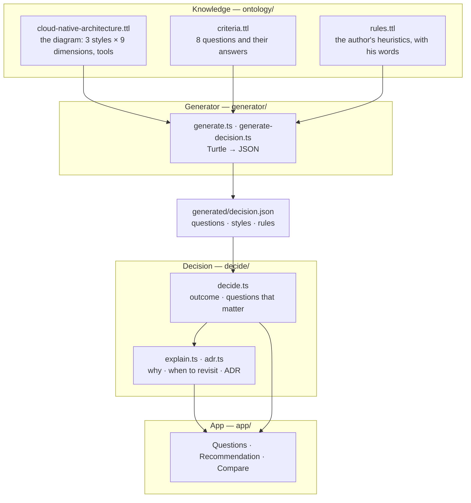

# Cloud architecture

Alok Sharan's infographic
[Microservices VS Serverless VS Modular Monolith](https://www.linkedin.com/feed/update/urn:li:activity:7514433067860582400/)
compares three architecture styles on 9 dimensions. It is a comparison sheet: it shows what each
style gives and costs, but not which one fits a team. This demo writes the diagram, and the
heuristics of the post that goes with it, down as an ontology, and builds a small app on it that
recommends a style for one team, says why, and says when to reconsider.

The app asks one question at a time, and only the questions whose answer can still change the
recommendation: the ontology holds the rules, so code can compute which questions matter. It is a
static page; everything runs in the browser.

> The diagram and the post are Alok Sharan's. They state no licence: the ontology extracted from
> the diagram, and the generated file that holds its content, are not licensed (see Licences).

## How it works



| Folder | What it holds |
| --- | --- |
| `ontology/` | The knowledge, in Turtle. `cloud-native-architecture.ttl`: the diagram, each style with its characteristics per dimension and its tools. `criteria.ttl`: the questions about the team's situation, each answer with a definition. `rules.ttl`: the author's heuristics as rules over the answers, each with the words it stands for |
| `generator/` | Reads the ontology and writes `generated/decision.json`. Git tracks it; a test fails when it is out of date |
| `generated/` | `decision.json`: the questions, the styles and the rules, the only file that the code reads |
| `decide/` | The decision, without UI: the outcome of the answers, the outcomes still possible and the questions that can change them (`decide.ts`), the explanation (`explain.ts`), the architecture decision record (`adr.ts`) |
| `app/` | The React app: the questions, the recommendation, and the diagram as a table |

## The rules

The post ends with the author's view: "Start with modular clarity. Use serverless for event-driven
execution. Move to microservices when scale, ownership, and domain boundaries justify the
operational cost." `rules.ttl` writes it as rules. The mapping of his words to answers is ours, and
each rule says it.

| Rule | Applies when | Recommends |
| --- | --- | --- |
| Move to microservices | high expected growth or a large team (scale), more than one team (ownership), clearly separate business areas (domain boundaries), and operations experience | Microservices for the system |
| Start modular | always: the first rule that applies decides | A modular monolith for the system |
| Serverless for events | scheduled or event-driven jobs | Serverless for those jobs, with the diagram's tool for the team's platform |
| Serverless for unpredictable traffic | traffic peaks that the team cannot foresee | Serverless for those parts |
| Caution: not yet | microservices would fit, but the team has little operations experience | A warning |
| Caution: sustained load | continuous processing | Keep it off serverless |

`decide/invariants.test.ts` checks the rules on all 13,122 ways to answer the questions: every
situation gets a recommendation, and every rule applies to some situation.

## Run it

```sh
bun install
bun run dev         # the app on http://localhost:3011
bun test            # the generator and the decision
bun run typecheck
bun run build       # a static site in dist/
```

## Licences

The code and the questions are MIT. The ontology extracted from the diagram
(`ontology/cloud-native-architecture.ttl`) and `generated/decision.json`, which holds its content,
are not licensed: the diagram states no licence, and all rights stay with its author
([`REUSE.toml`](../REUSE.toml), [`LicenseRef-NotLicensed`](../LICENSES/LicenseRef-NotLicensed.txt)).
