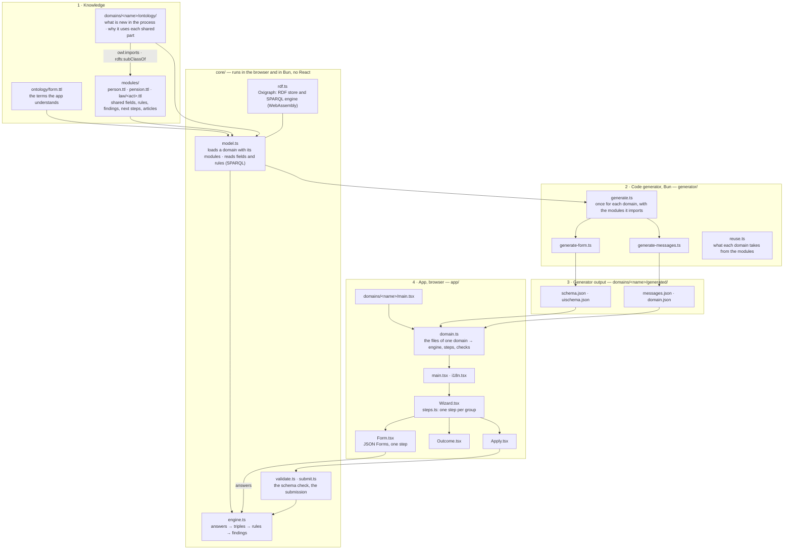

# eligibility: React + Bun

The browser stack of [`eligibility`](../). The knowledge model that it reads is in
[`../knowledge/`](../knowledge/): the paths `ontology/`, `modules/` and `domains/<name>/ontology/`
below are relative to it. The other stacks and the shared test cases are described in
[`../README.md`](../README.md).

A browser-only proof of concept, built like [`imci-fever`](../../imci-fever/) and made generic: a
step-by-step wizard for an application under a law or an ordinance. A knowledge model describes
one process (a *domain*): its questions, its rules, what follows, and the articles that each part
comes from. The app knows none of it: it reads the fields, the rules and the texts from the model,
and runs the rules (SPARQL) in the browser. It is a demonstration of the approach, not an
application for real use.

| Domain | Process | Shared modules | Page |
| --- | --- | --- | --- |
| [`wef`](../knowledge/domains/wef/) | Pension money for a home (BVG Art. 30a–30g, WEFV) | `person`, `pension` | `/eligibility/wef/` |
| [`vested-benefits`](../knowledge/domains/vested-benefits/) | The vested benefit in cash (FZG Art. 2–5, 25f) | `person`, `pension` | `/eligibility/vested-benefits/` |
| [`parental-allowance`](../knowledge/domains/parental-allowance/) | Maternity and other parent's allowance (EOG Art. 16b–16l) | none | `/eligibility/parental-allowance/` |

> **Demonstration only. Not legal or financial advice.** See each domain for what was checked.

## How it works

The same four parts as `imci-fever`, once for the app and once for each domain. One difference: the
rules are not compiled. The model holds them as SPARQL queries, and the engine runs them as they
are. The generator only makes the files that JSON Forms needs.

The knowledge has three layers. Each layer only uses the layers below it:

| Layer | Folder | What it holds | Used by |
| --- | --- | --- | --- |
| The form vocabulary | `ontology/form.ttl` | The terms that the app understands, and the texts of the app itself | Every domain |
| Shared modules | `modules/` | Knowledge that more than one process needs: fields, rules, findings, next steps, and the articles of each act | The domains that import them |
| Domains | `domains/<name>/ontology/` | One process: what is new in it, and why it uses each shared part | Its own page |



| Folder | Part | What it holds |
| --- | --- | --- |
| `../knowledge/ontology/` | Knowledge | `form.ttl`: the few terms that the app understands, and the texts of the app itself, for every domain |
| `../knowledge/modules/` | Knowledge | The shared modules (see below) |
| `../knowledge/domains/<name>/` | One domain | Its model (`ontology/`, the source of truth) and its `README.md` |
| `domains/<name>/` | Its entry in this app | Generated: `generated/`, `domain.ts`, `main.tsx`, `index.html`; written by hand: `test/` |
| `generator/` | Code generator | `bun run generate` writes, for each domain, the JSON Forms schema and UI schema from the SHACL shapes, the texts by language, and the region; and `generated/index.json`, the list of processes. Do not edit the output; a test fails if it is older than the model. `bun run reuse` prints what each domain takes from the modules |
| `core/` | Model and rules | Runs in the browser and in Bun (the generator, the tests, or a server), without React. `rdf.ts` loads Oxigraph; `model.ts` loads a domain with its modules and reads the fields and the rules; `engine.ts` runs the rules; `validate.ts` checks the answers against the schema; `submit.ts` decides on a submitted application |
| `app/` | App | React. `domain.ts` makes the engine, the steps and the checks of one domain. `Wizard.tsx`, `steps.ts` and `Form.tsx` are the wizard; `Outcome.tsx` the result; `i18n.tsx` the languages; `Apply.tsx` submits the application. `index.tsx` is the list of processes (`index.html`) |
| `test/` | Tests | `domains.test.ts`: the same checks for every domain, the imports, and the reuse |

Each test is next to the code it tests, on a small model of its own; the tests of a domain are in
its `test/` folder. `test-setup.ts` loads Oxigraph before the tests.

No file in `app/`, `core/` or `generator/` knows a domain or a module. The languages of a domain
are those of its title (the `rdfs:label` of its shape); its texts, the texts of the modules it
imports and the texts of the app in `form.ttl` must exist in each of them.

## Shared modules

A module is a Turtle file with its own `owl:Ontology`. A domain uses it in two steps, both standard:

1. **It imports the module** (`owl:imports`), so the module's files are loaded with the domain.
2. **It makes its class a subclass of the module's class.** In SHACL, a shape for a class also
   applies to the members of its subclasses. So the fields and rules of the module's shape become
   part of the domain's form:

   ```turtle
   fzg:Application rdfs:subClassOf pension:PensionApplication .   # pension:PensionApplication ⊑ person:PersonalApplication
   ```

| Module | Class | What it gives |
| --- | --- | --- |
| `person.ttl` | `person:PersonalApplication` | The step "You": date of birth, marriage or registered partnership, the spouse's written consent; the finding "written consent missing" and the next step "attach the consent", with their rules |
| `pension.ttl` | `pension:PensionApplication`, a subclass of the one above | The reference age (years and months) in the step "You"; the step "Pension fund" with the vested benefit |
| `law/<act>.ttl` | none | The articles of one act (BVG, WEFV, FZG, DBG, EOG), with their labels in four languages |

**A module says what a concept is; a domain says why it uses it.** The modules have no
`prov:wasDerivedFrom`. Each domain states the legal basis of the shared parts it uses, so the same
finding shows other articles in each process:

```turtle
person:ConsentMissing prov:wasDerivedFrom law:BVG-30c-5 .              # domains/wef
person:ConsentMissing prov:wasDerivedFrom law:FZG-5-2 , law:FZG-5-3 .  # domains/vested-benefits
```

**The imports must be closed.** `loadModel` (`core/model.ts`) refuses a domain that misses a module
it imports, or that loads a module that nothing imports. The generator finds the modules through the
imports; the domain's `domain.ts` lists them, and a test checks that both agree.

**Groups and orders.** The shared steps have fixed places: "You" is 1 and "Pension fund" is 3, so a
domain puts its own step at 2, or after 3. Within a step, the orders of the modules leave room for
each other: in "You", the date of birth is 1, the reference age 2 and 3, marriage 4 and consent 5.

### How much is reused

`bun run reuse` counts, for each domain, what comes from the shared modules (without the form
vocabulary and the app, which every domain shares):

```
┌────────────────────┬─────────┬─────────┬──────────────────────────────┬───────────┬─────────────────────────┐
│                    │ fields  │ rules   │ findings, next steps, values │ texts     │ articles in shared acts │
├────────────────────┼─────────┼─────────┼──────────────────────────────┼───────────┼─────────────────────────┤
│ parental-allowance │ 0 of 9  │ 0 of 15 │ 0 of 14                      │ 0 of 176  │ 0 of 10                 │
│    vested-benefits │ 6 of 13 │ 2 of 12 │ 2 of 13                      │ 56 of 212 │ 1 of 13                 │
│                wef │ 6 of 17 │ 2 of 18 │ 2 of 22                      │ 56 of 288 │ 9 of 23                 │
└────────────────────┴─────────┴─────────┴──────────────────────────────┴───────────┴─────────────────────────┘
```

- **wef and vested-benefits** are two processes of the same field of law. Almost half of the
  questions of vested-benefits, with their texts in four languages, come from the modules, and so do
  the rules on the spouse's consent.
- **parental-allowance** is a process of another field of law. It shares no knowledge with them, only
  the app, the engine and the form vocabulary: the steps, the yes/no answers, the severities and the
  texts of the app.

So the reuse comes from how close the processes are in the law, not from the technology.

**The modules came out of wef without changing it.** The shared parts of wef were moved to the
modules with their texts unchanged: the generated files of wef stayed byte for byte the same, and
every wef test passed, the 1,000 random applications included.

## Adding a domain

1. Write the model in `domains/<name>/ontology/`: one `sh:NodeShape` with a title and a
   `form:summary` in each language and a `form:region`, its groups and fields, its rules, values, findings and next steps, and their
   sources. A new language also needs the texts of the app in `ontology/form.ttl`; the generator
   names the missing ones.
2. Reuse what exists: import the modules that the process needs (`owl:imports`), make the class of
   the shape a subclass of theirs, and state the legal basis of the shared parts that it uses. Put
   the articles in the module of their act, `modules/law/<act>.ttl`, and a new act in a new module.
   When a second process needs a part of a domain, move that part to a module.
3. `bun run generate`: it writes the domain's entry in this app (`domains/<name>/`: `domain.ts`,
   `main.tsx`, `index.html` and `generated/`). Write its tests in `domains/<name>/test/`; the
   checks of `test/domains.test.ts` run on it without a change.
4. `bun run conformance` records its shared test cases (`../conformance/<name>.json`), which every
   stack must then decide the same.

`bun run dev` and `bun run build` find the new domain by its folder. It gets its own page,
`/<name>/` in development and `/eligibility/<name>/` on the site, with a link back to the list of
processes, and a card in that list (`index.html`, at `/` and `/eligibility/`): its title and
summary, from `generated/index.json`. In this folder, only one shared file changes: the domain table
at the top of this README.

### The form vocabulary

`form.ttl` defines what a domain model can tell the app, in addition to SHACL, SHACL Advanced
Features and PROV-O:

| Term | Meaning |
| --- | --- |
| `form:today` | The date of the evaluation. The engine adds it to `$this`; the person does not enter it |
| `form:region` | On the shape: the region whose way of writing dates and numbers the app uses, for example `CH` |
| `form:summary` | On the shape: one sentence about the process, in each language, for its card in the list of processes |
| `form:askedWhen` | On a field: a SPARQL ASK query. The field is asked only when it is true |
| `form:finding`, `form:Finding`, `form:severity` | What the rules found: `form:Refusal` and `form:NotYet` block the application, `form:Notice` does not |
| `form:nextStep`, `form:NextStep` | What follows when the application is allowed |
| `form:Value` | A derived property of `$this` that the app shows, for example the maximum amount |
| `form:yes`, `form:no` | The answers to yes/no questions |
| `form:Text` | A text of the app itself (buttons, headings, messages), in each language |

### The engine

`core/engine.ts` (about 100 lines) does four things:

1. The answers become triples about one focus node, `$this`, of the shape's `sh:targetClass`, with
   `form:today`. A choice becomes the IRI of the choice; a date an `xsd:date`.
2. The rules of the shapes (`sh:rule`, each a `sh:SPARQLRule` with a CONSTRUCT query) run in their
   `sh:order`, again and again, until no rule adds a new triple. The shapes are the domain's and
   those of the modules that apply to its class. `$this` is bound with a `VALUES`
   clause at the end of each query, as SHACL pre-binds it. The prefixes come from `sh:prefixes` and
   `sh:declare`, as in SHACL.
3. A field with `form:askedWhen` is asked when its ASK query is true. The answer to a field that is
   not asked does not count: the engine removes it and runs the rules again.
4. It reads back what the rules derived: the values, the findings and the next steps, with their
   sources. The application is allowed when every asked field with `sh:minCount 1` has an answer
   and no finding blocks it.

## The wizard

The steps are the categories of the generated UI schema, one for each `sh:PropertyGroup` that the
fields use, in their `sh:order`. A step is complete when each question that the engine asks has an
answer, and no answer has an error. Next on an incomplete step marks the open questions. The last
step, "Review and submit", lists the answers with a link back to each step, then the findings, the
next steps and the values. When nothing blocks the application, the person submits it.

## The submission

"Submit the application" calls `submit()` in `core/submit.ts`. It shows what a server would do with
the application: check the answers against the domain's schema and decide again with the same
engine and model. It replies with a refusal (`invalid` with the wrong fields, `incomplete` with the
missing fields, `refused` with the findings that block) or a receipt (a reference, the date, the
values, the findings and the next steps). The replies hold ids of the model, so the page shows them
in its language. Nothing is sent and nothing is stored. In the browser this check protects nothing;
the engine and the models also run in Bun (the tests do), so they can move to a server as they are.

## Commands

```
bun install
bun run dev        # generate, then serve each domain at http://127.0.0.1:3518/<name>/
bun run test       # run the tests (they fail if a generated file is old)
bun run build      # generate, then write one static site per domain to dist/<name>/
bun run typecheck
```

Each `dist/<name>/` contains only static files with relative paths, so any static host can serve it
from any path, for example GitHub Pages at `/eligibility/wef/`.

## Licence

Swiss laws and ordinances are not protected by copyright (URG Art. 5), so this folder, the
knowledge models and modules included, is MIT licensed, like the code of the repository.
