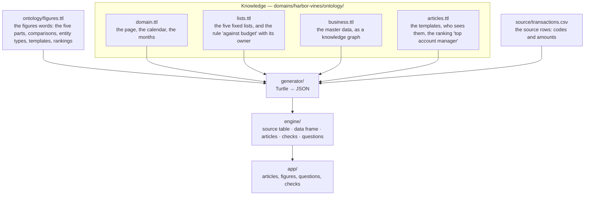

# Figures

Business figures from a knowledge model. The example is Harbor Vines, a drinks wholesaler, from the
video [Kiraa Engine Explainer](https://youtu.be/j5bAryILBCM) (Kiraa, 2026). The video explains an
engine that calculates every figure before a language model sees it:

1. **Source table:** the transactions and the budget, joined with the master lists.
2. **Data frame:** one row for each account manager, one column for each **variable**. A variable
   has a name of five parts, always in this order, and each part comes from a fixed list:
   measure, time basis, time slice, scenario, suffix. `SALES_TFY_CP_ACT_VAL` is sales, this
   financial year, current period, actual, value.
3. **Templates:** texts with blanks, such as "_ sold _ in August against the budget of _. That's _
   above plan." A blank is bound to a variable, or it is an instruction: "take actual, subtract
   budget and divide by budget".
4. **Articles:** the templates with their blanks filled. The language model reads the articles, and
   does no calculations.

This demo writes the same engine down as a knowledge model, with one change: every rule is part of
the model, with an owner, and not an instruction in a template. Then checks find what the
templates hide.

> The name Harbor Vines, its people, customers and products, the data of August and the text of the
> template are from Kiraa's video. They are not licensed (see Licences). The video does not show
> the dates, the product of each sale, or which customers Anna has: we chose them so that the
> totals are the ones of the video. The video's caption says "Delhi Duo"; we wrote "Deli Duo".
> September is invented for this demo.

## One model, four files



| File | What it holds |
| --- | --- |
| `lists.ttl` | The lists of the video: sales and margin; this financial year; current period, year to date, full year; actual and budget; value. And ours: the scenario `VAR` (against budget) and the suffix `PCT` (percent) |
| `business.ttl` | Anna, Tom and Sam; Cafe Uno, Deli Duo, Bar Trio and Pub Quattro, each with its account manager; cola and lemonade; the roles; Finance, the owner of the rule |
| `articles.ttl` | The account manager's template and the sales manager's template, with no calculation in them; the two definitions of "top account manager", and no decision |
| `test/as-shown/articles.ttl` | The template as the video shows it, with its calculation, in place of `articles.ttl` |

The code (`engine/`, `generator/`, `app/`) knows the figures words, and nothing about drinks or
sales.

### What is different from the video

| In the video | In the model |
| --- | --- |
| "Above plan" is an instruction in the template | `VAR` is a scenario of the model: `(actual − budget) / budget`, with an owner (Finance) and words for both signs |
| The name grammar is a convention | The five lists and their order are in the model, and the engine refuses a name that breaks them |
| "Who was our top account manager?": the LLM compares the articles | "Top account manager" is a ranking with two definitions, by sales and by result against budget, and no decision. The article says when the two give different answers |
| The articles of a role are a setting | Each template says which roles see its articles, and which see only their own |

## What the checks find

`bun run verify` checks the model. Structure: what the model says, in any month. A month: what its
articles say in that month.

```
┌──────────────┬───────────┬────────┬───────────┐
│              │ structure │ August │ September │
├──────────────┼───────────┼────────┼───────────┤
│ harbor-vines │ 6         │ 0      │ 3         │
└──────────────┴───────────┴────────┴───────────┘
✗ open decision: top account manager: 2 definitions (by sales, by result against budget), no decision
✗ no article: measure margin
✗ no article: time slice full year
✗ no article: entity type customer
✗ no article: entity type product
✗ no data: measure margin has no source rows
September  ✗ no value: Sam: SALES_TFY_CP_VAR_PCT: the budget is 0
September  ✗ no value: Sam: SALES_TFY_YTD_VAR_PCT: the budget is 0
September  ✗ decision: top account manager in September: by sales, Anna; by result against budget, Tom
```

The template as the video shows it:
`bun run verify harbor-vines domains/harbor-vines/test/as-shown/articles.ttl`

```
✗ rule in a template: AccountManagerArticle: "(SALES_TFY_CP_ACT_VAL - SALES_TFY_CP_BUD_VAL) / SALES_TFY_CP_BUD_VAL" has no name and no owner
…
September  ✗ wording: Anna: "That's -10% above plan."
September  ✗ no value: Sam: (SALES_TFY_CP_ACT_VAL - SALES_TFY_CP_BUD_VAL) / SALES_TFY_CP_BUD_VAL: division by 0
```

| Check | Finds |
| --- | --- |
| grammar | a blank whose name is not a variable: not five parts, or a part that is not in its list |
| unknown blank | a blank that the engine does not know, or a ranking that is not in the model |
| rule in a template | a calculation in a template: no name, no owner, and no other template can use it |
| no owner | a rule of the model (a comparison) without an owner |
| open decision | a ranking with more than one definition and no decision |
| no article | a concept of the lists, or an entity type, that no template uses: a question about it cannot be answered |
| no data | a measure without source rows |
| no value (a month) | a figure without a value, and why |
| wording (a month) | a calculation that gives a negative number, in words that are the same for any sign |
| decision (a month) | an open ranking whose definitions give different answers |

In August, the data of the video, the model and the video agree, and no month check finds
anything. September shows what August hides.

## Questions

The app takes a question, and matches its words to the concepts of the model (`rdfs:label` and
`skos:altLabel`). The concepts decide which articles an LLM would read. If no article can answer,
the answer is "I do not know", with the reason. The demo calls no LLM: it shows what an LLM would
get.

| Question | Result |
| --- | --- |
| Who was our top account manager in August and how did they go against budget? | The sales manager's article, and a note: two definitions, no decision |
| The same question, with the template of the video | Anna's and Tom's articles, and a note: the model does not define "top", so the LLM decides it |
| What was our margin in August? | I do not know: no article has the margin, and there are no source rows for it |
| Which product sold most at Cafe Uno? | I do not know: no article is about a product |
| How did Anna do? (asked by Tom) | I do not know: Tom does not see Anna's article |

## Run it

```sh
bun install
bun run dev         # http://127.0.0.1:3013/harbor-vines/
bun test            # the articles of the video, the rules, the checks, the questions
bun run verify      # the checks of the model, as a table
bun run typecheck
bun run build       # a static site in dist/harbor-vines/
```
